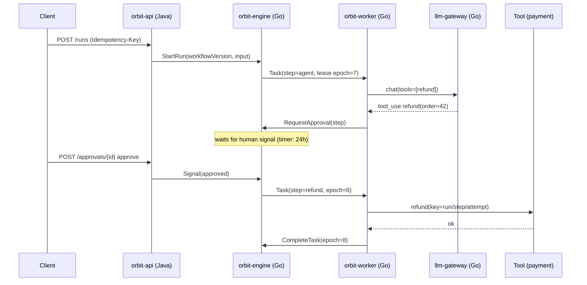

# 📝 Design Docs & ADRs

At top companies, **writing is how engineering decisions get made**. Being able to write a clear design doc is a promotion-level skill, and it makes system design interviews much easier.

## Design doc skeleton (1–5 pages)
1. **Context & problem.** Why now? Who's affected?
2. **Goals / non-goals.** Explicit scope
3. **Requirements.** Functional and non-functional (scale, latency, SLOs, cost)
4. **Proposed design.** Diagram, APIs, data model, flows (sequence diagrams)
5. **Alternatives considered.** At least 2, with a trade-off table
6. **Failure modes & mitigations.** What breaks, and how you detect and recover
7. **Security & privacy**
8. **Rollout plan.** Feature flags, migration, backfill, rollback
9. **Observability.** Metrics, alerts, dashboards
10. **Open questions**

## ADR (Architecture Decision Record)
Short (≤ 1 page), immutable, numbered. Template: `99 Templates/ADR`.
Write an ADR for every meaningful Orbit decision, e.g.:
- ADR-000: Java for the control plane, Go for the data plane
- ADR-001: A modular monolith control plane first
- ADR-003: Tenant isolation via Postgres RLS
- ADR-004: The workflow definition format (JSON DSL vs code)
- ADR-006: Our own durable engine vs Temporal
- ADR-007: Postgres `SKIP LOCKED` queue vs Kafka for task dispatch
- ADR-010: Hybrid retrieval (pgvector + FTS + rerank) vs a dedicated vector DB

## Diagrams
- **C4 model**: Context → Container → Component (Simon Brown)
- **Mermaid** is native to Obsidian. Use `sequenceDiagram`, `flowchart`, `erDiagram`

## Resources
- *Design Docs at Google* (industrialempathy.com)
- Michael Nygard's original ADR post; adr.github.io
- c4model.com
