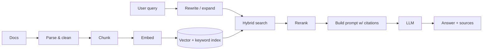

# 📚 RAG (Retrieval-Augmented Generation)

## Pipeline

## Checklist (core → advanced)
- [ ] Ingestion: parsing PDFs/HTML, metadata, incremental updates, deletions
- [ ] Chunking strategies: fixed, recursive, semantic, structure-aware; overlap; parent-child chunks
- [ ] Embedding models: choosing, dimensions, cost; re-embedding on model change
- [ ] Vector stores: **pgvector** (HNSW/IVFFlat indexes) ⭐, Qdrant, OpenSearch k-NN
- [ ] **Hybrid search** (BM25 + vector) with reciprocal rank fusion ⭐
- [ ] **Reranking** (cross-encoders / rerank APIs)
- [ ] Query transformation: rewriting, multi-query, HyDE, decomposition
- [ ] Metadata filtering and **access control** (per-user document permissions!)
- [ ] Contextual retrieval (adding context to chunks before embedding)
- [ ] Citations and "I don't know" behavior
- [ ] Agentic RAG (the agent decides when and what to retrieve); GraphRAG (awareness)
- [ ] **Evaluation**: retrieval (recall@k, MRR, nDCG) and generation (faithfulness, answer relevance) → [[Evals, Guardrails & LLMOps]]
- [ ] Long context vs RAG: the trade-offs

## 🧪 Labs (🟢 warm-up → 🟡 core → 🔴 hard → ⚫ boss)
- [ ] 🟡 Ingestion pipeline (W18) → a baseline naive RAG with an eval set of 100 Qs
- [ ] 🔴 Hybrid + RRF + rerank + contextual chunks; measure each step's gain
- [ ] 🔴 Document ACLs at query time + a leakage test
- [ ] ⚫ **BM25 + HNSW from scratch in Go** vs pgvector (recall/latency curves)

## 🧠 Cognitive tasks
- [ ] Error analysis on 30 failures → categorize → fix the biggest bucket
- [ ] Constraint flip: 1,000× more documents; what breaks first?

## 🛰️ Orbit integration
- [ ] UC2 knowledge copilot; RAG steps in UC3, UC4, UC6, UC7, UC8, UC10

> [!info] Go deeper
> ⚙️ [[LLM Inference Internals]] · [[PostgreSQL Internals]] · 🧩 [[AI & Agent Patterns]]

