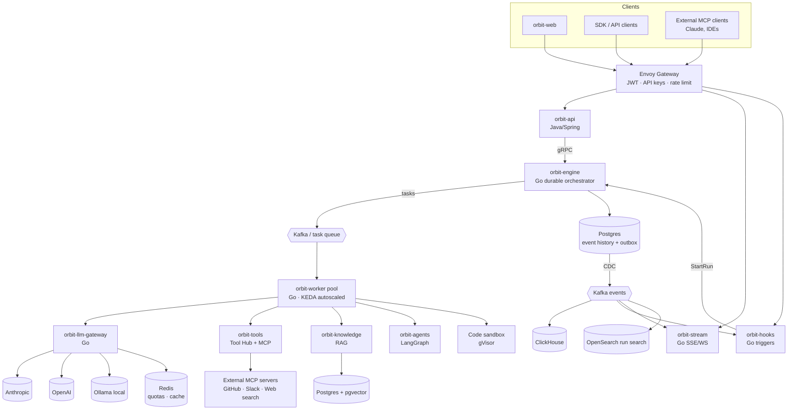

# 🛰️ Orbit: AI Workflow & Agent Platform (Capstone)
*A multi-tenant platform where teams build, run, and observe **AI workflows and agents**: LLM calls, tool calling, RAG, human approvals, triggers, evals. Think n8n + Temporal + LangGraph + an LLM gateway, built by you in **Java + Go** (with Python where the AI ecosystem demands it).*

> [!important] Why this project beats a CRUD app
> An AI platform forces you through **every hard problem** in modern backend engineering:
> - **Durable execution**: runs survive crashes, with retries and at-least-once execution but *exactly-once effects*
> - **Distributed coordination**: task leases, fencing tokens, timers, idempotency
> - **Multi-tenancy**: quotas, fairness (noisy neighbors), isolation, RLS
> - **Streaming**: tokens flow LLM → gateway → worker → browser, with backpressure
> - **Data pipelines**: document ingestion → chunk → embed → index; usage events → OLAP
> - **Security**: prompt injection, least-privilege tools, sandboxed code, secrets
> - **AI engineering**: tool calling, RAG, agents, MCP, HITL, evals, guardrails, cost control
>
> In interviews you can say "I designed and built an AI workflow platform" and go deep on any layer.

## Services
| Service | Lang | Responsibility | Stores | Introduced |
|---|---|---|---|---|
| **orbit-api** (control plane) | Java / Spring Boot | Tenants, users, API keys, workflow definitions (versioned), prompt registry, tool registry, REST + GraphQL | Postgres (RLS) | v1 |
| **orbit-engine** (orchestrator) | **Go** | Durable run state machine, event history, scheduling, timers, retries, HITL signals, compensation | Postgres + Kafka | v0 → v2 |
| **orbit-worker** (step runners) | **Go** | Execute steps: `llm`, `tool`, `http`, `code`, `rag.search`, `agent`, `map`, `branch`, `human` | — | v1 |
| **orbit-llm-gateway** | **Go** | Provider adapters, streaming, fallback/routing, per-tenant quotas, exact + semantic cache, usage metering, PII redaction | Redis, Kafka | v1 → v4 |
| **orbit-knowledge** | Java / Spring AI | Collections, uploads (S3 presigned URLs), ingestion pipeline, hybrid retrieval, rerank, ACL, citations | Postgres + pgvector, S3/MinIO | v3 → v4 |
| **orbit-tools** (Tool Hub + MCP) | Java / Spring AI | Tool registry, OAuth connectors, encrypted secrets, **MCP client** (external servers) + **Orbit as MCP server** | Postgres, Vault | v1 → v4 |
| **orbit-agents** | Python / LangGraph | Complex agents (ReAct, plan-execute, supervisor), checkpoints, interrupts | Postgres | v4 |
| **orbit-hooks** | **Go** | Triggers (cron, inbound webhooks, Kafka), outbound webhooks (HMAC, retries, DLQ) | Postgres, Kafka | v2 |
| **orbit-stream** | **Go** | WebSocket/SSE fan-out of run events + tokens; resume from last event ID | Redis pub/sub | v1 |
| **orbit-evals** | Python + Java | Eval suites, LLM-as-judge, CI regression gates, online sampling | Postgres, ClickHouse | v4 |
| **orbit-analytics** | CDC → Kafka → ClickHouse | Usage, cost, latency, eval scores per tenant; billing | ClickHouse | v3 |
| **orbit-web** | React + TS | Workflow builder (React Flow), playground, run timeline/trace viewer, approvals inbox, knowledge UI | — | v1 |
| Edge | Envoy Gateway + Keycloak | TLS, JWT, API keys (ext_authz in Go), rate limits, routing | — | v3 |

## Architecture (target state)


## The 12 hard problems you will solve (your interview stories)
1. **Exactly-once effects** from at-least-once execution (idempotency keys per step attempt, event-history replay)
2. **Task leasing + fencing tokens** when a worker freezes (GC pause) and wakes up after its lease expired
3. **Timers at scale**: millions of scheduled wake-ups (Postgres index vs Redis ZSET vs timing wheel)
4. **Multi-tenant fairness**: one tenant submits 1M runs (admission control, weighted fair queuing)
5. **Distributed quotas**: token-bucket per tenant across N gateway replicas (Redis Lua + local batching)
6. **End-to-end token streaming** with backpressure, proxies, and resume-on-reconnect
7. **Workflow versioning**: in-flight runs stay pinned to old definitions while new versions deploy
8. **RAG with document-level ACLs** and incremental re-indexing
9. **Safe tool use**: least privilege, HITL approvals, prompt-injection defense, sandboxed code execution
10. **Cost control**: model routing/cascades, caching, per-tenant budgets, cost attribution
11. **Evaluation as a CI gate** for prompts, models, and agents
12. **Observability for non-deterministic systems**: tracing LLM calls, tools, and agents end to end

## Versions (each maps to a phase)
| Version | Weeks | Theme | Note |
|---|---|---|---|
| v0 | W1–W4 | Building blocks: in-memory DAG executor, rate limiter, KV, expression language | [[Orbit v0 - Building Blocks]] |
| v1 | W5–W9 | Core platform: control plane, LLM gateway, **tool calling**, streaming, multi-tenancy | [[Orbit v1 - Core Platform]] |
| v2 | W10–W14 | **Durable workflow engine**: event history, leases, Kafka, triggers, sagas, HITL | [[Orbit v2 - Durable Workflows]] |
| v3 | W15–W18 | Cloud native: K8s + KEDA, Envoy, sandbox, OTel, ingestion pipeline, analytics | [[Orbit v3 - Cloud Native]] |
| v4 | W19–W22 | **Agents, RAG, MCP, evals, guardrails** + all reference apps | [[Orbit v4 - Agents, RAG & MCP]] |
| v5 | W23–W24 | Scale, cost, portfolio | [[Orbit v5 - Scale & Polish]] |

All use cases: [[Orbit - Use Cases]] · Weekly work: [[Labs Index]] and the `Assignments - Phase N` notes

## Repo layout (monorepo)
```
orbit/
  proto/                    # buf-managed protobuf (engine, worker, gateway APIs, events)
  services/
    api/ knowledge/ tools/  # Java 25, Spring Boot 4, Gradle multi-module
    engine/ worker/ llm-gateway/ hooks/ stream/   # Go
    agents/ evals/          # Python (uv)
  web/                      # React + TS + Vite
  deploy/ compose/ helm/ terraform/ argocd/
  docs/ adr/ design/ runbooks/ postmortems/ blog/
  evals/ datasets/ suites/
  loadtest/                 # k6 scripts
```

## Definition of done (every version)
- [ ] Tagged release + CHANGELOG · [ ] Architecture diagram updated · [ ] ADRs for each decision
- [ ] Tests: unit + integration (Testcontainers) + at least one chaos/failure test
- [ ] A numbers section (latency, throughput, cost) · [ ] A blog post · [ ] Self-graded with the [[Grading Rubric]]
