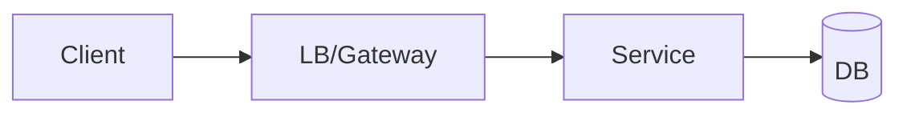

# Design: {{title}}

## 1. Requirements
**Functional:**
-
**Non-functional:** scale · latency · availability · consistency · durability

## 2. Estimates
- DAU: · QPS (avg/peak): · Storage/yr: · Bandwidth:

## 3. API
```

```

## 4. Data model & storage choice

## 5. High-level design


## 6. Deep dives (the hard parts)
1.
2.

## 7. Bottlenecks, failure modes, monitoring

## 8. Trade-offs I made

## 9. Gaps vs. the reference solution
-
